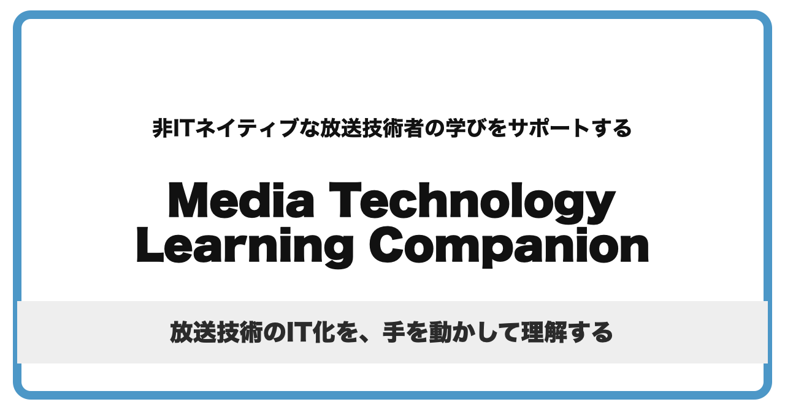

# Media Technology Learning Companion (mtlc)

Media Technology Learning Companion (mtlc) は、非ITネイティブな放送技術者の学びを支えるコンパニオン（伴走者）です。放送技術のIT化について、自分のペースで手を動かし、理解を深めていくための入口や手がかりを提供します。

## 概要

放送設備のIP化やソフト化では、映像・音声、同期、制御、測定などをIT技術の上で扱う場面が増えています。一方で、規格書や解説を読むだけでは、実際の動きやつまずきやすい点をイメージしにくいことがあります。

mtlcは、皆さんが規格、OSS、実機検証、現場での経験と行き来しながら学んでいく過程で、最初の一歩や確認の手がかりをそばで支えることを目的としています。

教材では、標準化団体や企業が公開しているOpen Source Software (OSS) を活用します。GStreamer、Docker、NMOS、PTP、WiresharkなどをPC上で動かしながら、「何が起きているのか」を確かめる機会を作ります。

## 対象読者

- 放送技術のIT化について、学び始めるきっかけがほしい方
- SDI中心の設備からIP化への移行を、自分の手で確かめながら理解したい方
- NMOS、PTP、ST 2110、Test & Measurementなどの入口を探している方
- OSSやGitHubに慣れながら、放送技術の学習を少しずつ進めたい方

## カリキュラム

カリキュラムの全体像は [curriculum.md](curriculum.md) を参照してください。各コースの公開状況（公開中・作成中・構想中）も curriculum.md に記載しています。各コースは、皆さん自身の学びを進めるための道しるべとして、随時、修正・追加していきます。

各テーマの紹介記事は [note](https://note.com/mtlc) で発信しています。

## 参加方法

各カリキュラムへの参加は有料を予定しています。参加費は、教材の継続的な整備と改善に役立てます。

参加者には、カリキュラムごとのGitHubのプライベートリポジトリへのアクセス権を付与します。参加を希望される方、興味を持たれた方は、まずは以下までメールでお問い合わせください。

mtlc.project@gmail.com

## 運営者

本ポータルは、非ITネイティブな放送技術者が作成・運営しています。筆者自身が学習や実務でつまずいた経験を反映し、同じような立場の方の学びに寄り添うコンパニオンを目指しています。運営者の紹介は [note](https://note.com/mtlc) をご覧ください。
